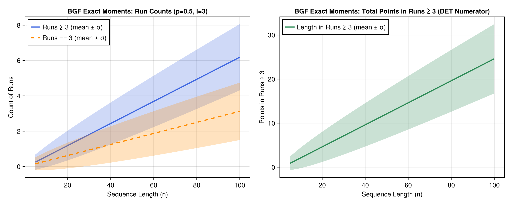

# Binary word double runs

Probability for consecutive double runs (either 0s or 1s) of lenght k in binary words of length n, use `p_binary_words_doub_runl(k,n)`

```julia-repl
julia> using AnalyticComb

julia> p_binary_words_doub_runl(6,200) #e.g. 100000011010... or 01111110101...
0.166...
```

# Restricted summands problem

Solving Polya partitions with restricted summands (denumerants) problem[^1]. 
What is the number of ways of giving change of 99 cents using pennies (1 cent), nickels (5 cents), dimes (10 cents) and quarters (25 cents)?

That is, the number of ways to obtain 99 by summing 1s,5s,10s and 25s.   

Or number of distinct sets ``S = \{k_1,k_2,_k_3,k_4\}\, \quad k \in \mathbb{N}`` satisfying the equation:  

$$1 k_1  + 5 k_2  + 10 k_3  + 25 k_4  = 99.$$

The generating function is: ``P(z) = SEQ(z) \cdot SEQ(z^5) \cdot SEQ(z^{10}) \cdot SEQ(z^{25})`` and the solution is the
cofficient of ``z^{99}`` in the expansion: ``[z^{99}] T(P(z))``.  

$$T(P(z)) = \cdots + 213 z^{99} + \cdots$$

Function `restricted_sum_part_gf(r)` returns the generating function for elements in `r` and `restricted_sum_part(k,r)` returns the coefficient in ``z^k`` for the generating function with elements in `r`.  

```julia-repl
julia> restricted_sum_part_gf([1,5,10,25]) # examine the generating function SEQ(z)*SEQ(z^5)*SEQ(z^10)*SEQ(z^25)
                 1                  
────────────────────────────────────
        ⎛     5⎞ ⎛     10⎞ ⎛     25⎞
(1 - z)⋅⎝1 - z ⎠⋅⎝1 - z  ⎠⋅⎝1 - z  ⎠

julia> restricted_sum_part(99,[1,5,10,25]) # Counts for 99 as a sum of elements in (1,5,10,25).
213
```

# Bivariate Generating Functions (BGFs) & Exact Moments

Following Chapter III (*Combinatorial Parameters and Multivariate Generating Functions*) of Flajolet & Sedgewick[^2], an auxiliary variable ``u`` can **mark** a combinatorial parameter ``\chi`` while ``z`` marks the size ``n``:

$$A(z, u) = \sum_{n, k \ge 0} a_{n,k} z^n u^k$$

By **Proposition III.2 (Moments from BGFs, p. 158)**, differentiating ``A(z, u)`` with respect to ``u`` and evaluating at ``u = 1`` yields the exact factorial moments of ``\chi`` over objects of size ``n``:

$$\mathbb{E}_n(\chi) = \frac{[z^n] \partial_u A(z, u)|_{u=1}}{[z^n] A(z, 1)}, \qquad \mathbb{E}_n(\chi(\chi - 1)) = \frac{[z^n] \partial_u^2 A(z, u)|_{u=1}}{[z^n] A(z, 1)}$$

## Summands in Integer Compositions (Example III.5)

Using the marked sequence operator `SEQ(B, u)` where ``u`` marks each summand in ``I(z) = \frac{z}{1-z}``, `bgf_moments` extracts the exact mean, variance, standard deviation, and total count:

```julia-repl
julia> using AnalyticComb

julia> z, u = SymPy.symbols("z u");

julia> C_zu = SEQ(z / (1 - z), u) # BGF for compositions with u marking number of summands
     1     
───────────
    u⋅z    
1 - ───────
     1 - z 

julia> bgf_moments(C_zu, 10; z=z, u=u)
(mean = 5.5, var = 2.25, std = 1.5, count = 512.0)
```

## Marked Consecutive Runs in Weighted Binary Words

For Bernoulli trials with probabilities ``(p, q)``, `weighted_bin_runs_bgf` and `weighted_bin_runs_moments` mark run statistics of threshold ``l`` across sequences of length ``n``:

- `mode="count_ge"`: Number of maximal runs of length ``\ge l``
- `mode="length_ge"`: Total number of elements belonging to runs of length ``\ge l`` (the numerator of RQA **Determinism**)
- `mode="count_eq"`: Number of maximal runs of exact length ``l``
- `mode="double_count_ge"`: Number of maximal runs of either outcome (``p`` or ``q``) of length ``\ge l``

```julia-repl
julia> weighted_bin_runs_moments(0.5, 0.5, 3, 50; mode="count_ge")
(mean = 3.25, var = 1.796875, std = 1.340475661845451, count = 1.0)

julia> weighted_bin_runs_moments(0.5, 0.5, 3, 50; mode="length_ge")
(mean = 12.75, var = 31.046875, std = 5.571972271992566, count = 1.0)
```




[^1]: Flajolet, P., & Sedgewick, R. (2009). Analytic combinatorics. Cambridge University press. Page 43
[^2]: Ibid. Chapter III, Pages 158–170
