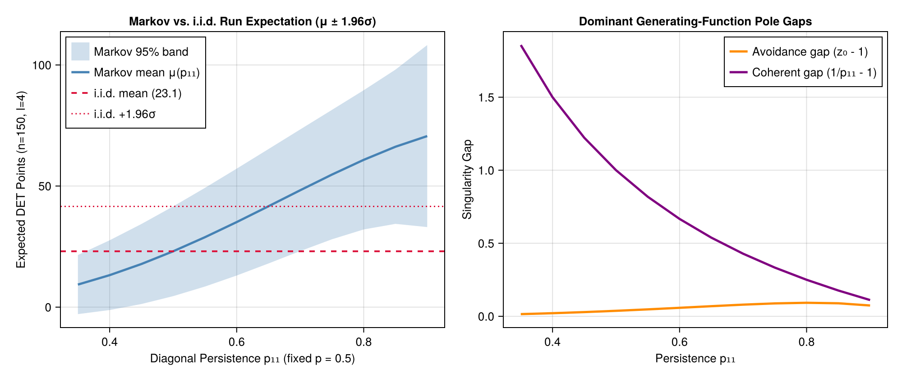

```@meta
CurrentModule = AnalyticComb
```

# Vignette: Markov Chains, DNA Motif Statistics, State Graphs & Dominant Poles

Classical combinatorial tests assume independent, identically distributed (i.i.d.) draws. In measured biological, physical, and behavioral sequences, successive observations frequently exhibit serial dependence (nucleotide stacking in DNA, persistence in daily weather anomalies) or internal self-overlap (homopolymer repeats). Ignoring these structures leads to miscalibrated $p$-values and false discoveries.

This vignette demonstrates how `AnalyticComb.jl` models these phenomena analytically across four empirical settings.

---

## 1. DNA Base Composition & Persistence: Avoiding False Islands (`markov_bin_runs_moments`)

Consider a 150-base-pair (bp) DNA segment coded as purine/GC (`1`) vs. pyrimidine/AT (`0`). Suppose the overall GC fraction is $50\%$ ($p_{\text{stat}} = 0.5$), so an i.i.d. test assumes $p = 0.5$ at every position. However, real genomic sequences exhibit dinucleotide stacking persistence—for example, $p_{11} = P(\text{GC at } t+1 \mid \text{GC at } t) = 0.80$.

Testing for clusters (runs) of length $l \ge 4$ under both models yields:

```julia
using AnalyticComb

# Coin-flip (i.i.d.) null: p = 0.5, run length >= 4 in n = 150 bp
m_iid = weighted_bin_runs_moments(0.5, 0.5, 4, 150; mode="length_ge")
# mean = 23.062, std = 9.451

# 1st-order Markov null with identical 50% GC content, but dinucleotide persistence p11 = 0.80
m_mkv = markov_bin_runs_moments(0.8, 0.2, 0.2, 0.8, 4, 150; mode="length_ge")
# mean = 60.826, std = 14.666
```

**Data Interpretation:**
If $55\text{ bp}$ in the 150-bp window belong to GC-runs of length $\ge 4$:
- Under the **i.i.d. null**, $55$ bases corresponds to $Z = (55 - 23.062) / 9.451 = +3.38$, falsely flagging the region as an anomalous GC island.
- Under the **Markov null**, $60.83 \pm 14.67$ bases is expected from dinucleotide persistence alone ($Z = -0.40$), showing that the observed clustering reflects background compositional stickiness rather than a distinct functional island.



*Left:* As diagonal persistence $p_{11}$ increases at fixed marginal frequency $p = 0.5$, the expected run-length mass climbs far above the i.i.d. baseline (red dashed line). *Right:* The coherent singularity gap $1/p_{11} - 1$ decays toward zero as $p_{11} \to 1$.

---

## 2. DNA Motif Enrichment: Homopolymer `AAAA` vs. Palindrome `ACGT` (`pattern_pval`)

Consider scanning a 500-bp promoter region over the uniform 4-letter DNA alphabet $\{\text{A}=1, \text{C}=2, \text{G}=3, \text{T}=4\}$ ($p_i = 0.25$) for two 4-mer motifs: the homopolymer `AAAA` (`[1, 1, 1, 1]`) and the restriction-like palindrome `ACGT` (`[1, 2, 3, 4]`).

Suppose an experiment observes **$6$ occurrences** of the target 4-mer in $500\text{ bp}$:

```julia
using AnalyticComb, TaylorSeries

probs4 = fill(0.25, 4)
z_ac = Taylor1(Float64, 4)

# Autocorrelation polynomials encode self-overlap structure
gamma_aaaa = autocorrelation_poly([1, 1, 1, 1], probs4, z_ac)
# 1.0 + 0.25 z + 0.0625 z^2 + 0.015625 z^3

gamma_acgt = autocorrelation_poly([1, 2, 3, 4], probs4, z_ac)
# 1.0

mom_aaaa = pattern_occurrences_moments([1, 1, 1, 1], probs4, 500; overlapping=true)
# mean = 1.9414, var = 3.1593, std = 1.7774

mom_acgt = pattern_occurrences_moments([1, 2, 3, 4], probs4, 500; overlapping=true)
# mean = 1.9414, var = 1.8885, std = 1.3742

# Exact combinatorial p-value P(X_500 >= 6)
p_aaaa = pattern_pval([1, 1, 1, 1], probs4, 6, 500)  # 0.044526
p_acgt = pattern_pval([1, 2, 3, 4], probs4, 6, 500)  # 0.013176
```

**Data Interpretation:**
Both 4-mers have the exact same expected count ($497 \times 4^{-4} = 1.9414$). However, a 5-bp tract `AAAAA` generates two overlapping `AAAA` hits, whereas `ACGT` cannot overlap itself ($\gamma_{\text{ACGT}}(z) = 1$). Consequently, `AAAA` has $67\%$ higher variance ($3.159$ vs. $1.889$), and observing $6$ hits yields a **3.4× larger $p$-value** for `AAAA` ($p = 0.0445$) than for `ACGT` ($p = 0.0132$). In motif-discovery pipelines, accounting for $\gamma_{\mathfrak{p}}(z)$ prevents spurious over-ranking of repetitive homopolymers.

---

## 3. Clinical State Transitions & Structural Walk Complexity (`transfer_matrix_moments`, `graph_closed_walks_gf`)

Consider a 4-stage longitudinal disease/recovery model (`1 = Susceptible`, `2 = Exposed`, `3 = Infectious`, `4 = Recovered`) tracked over $n = 200$ observation intervals, where each stage advances clockwise with probability $0.8$, remains in place with $0.1$, or skips/relapses with $0.1$:

```julia
P = [
    0.1 0.8 0.1 0.0;
    0.0 0.1 0.8 0.1;
    0.1 0.0 0.1 0.8;
    0.8 0.1 0.0 0.1
]
M_forward = [0.0 1.0 0.0 0.0; 0.0 0.0 1.0 0.0; 0.0 0.0 0.0 1.0; 1.0 0.0 0.0 0.0]

# Exact finite-sample moments for forward stage progressions over 200 steps
tm = transfer_matrix_moments(P, M_forward, 200)
# mean = 160.0, var = 32.0, std = 5.657

# Adjacency support graph A = (P > 0): closed walk counts and topological entropy
A = Int.(P .> 0)
gf = graph_closed_walks_gf(A, 6)
gf.closed_walks        # [4.0, 8.0, 28.0, 84.0, 244.0, 728.0]
gf.zeta_inv_coeffs     # [1.0, -4.0, 4.0, -4.0, 3.0]
gf.spectral_radius     # 3.0
gf.topological_entropy # 1.0986 (= log(3))

# Random deterministic mapping baseline for n = 100 discrete states
rm = random_mapping_moments(100)
# expected_cyclic_nodes = 12.21, expected_components = 2.979
```

**Data Interpretation:**
- Over $200$ steps, the model predicts $160.0 \pm 5.66$ forward progressions; an observed cohort with only $142$ forward steps ($Z = -3.18$) would indicate significant clinical slowing or treatment arrest.
- The spectral radius $\rho(\mathbf{A}) = 3.0$ and topological entropy $h_{\text{top}} = \log 3 \approx 1.0986\text{ nats/step}$ quantify the branching freedom of allowed transitions (3 outgoing pathways per state).
- `random_mapping_moments(100)` provides the exact baseline for a null deterministic map on $100$ states: on average, $12.21$ states lie on periodic cycles partitioned into $2.98$ attractor basins.

---

## 4. Dominant Singularity Gaps as Critical Slowing-Down Indicators (`markov_dominant_pole`)

In analytic combinatorics, the coherent survival pole $z_{\text{coh}} = 1/p_{11}$ measures how rapidly consecutive runs decay:

```julia
pole = markov_dominant_pole(0.8, 0.2, 0.2, 0.8, 4)
pole.persistence_pole  # 1.25 (= 1 / p11)
pole.persistence_gap   # 0.25 (= 1 / p11 - 1)
```

**Data Interpretation:**
In physical and physiological monitoring, an approach of $1/p_{11} - 1 \to 0^+$ indicates **critical slowing down** or **regime lock-in**: perturbations no longer break the active state, and the system lingers in persistent trajectories over progressively longer timescales.
